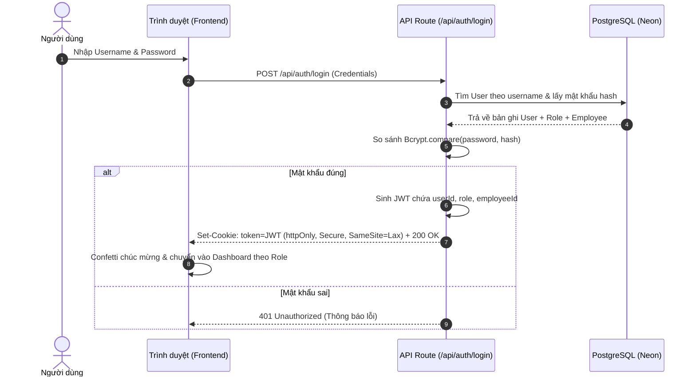
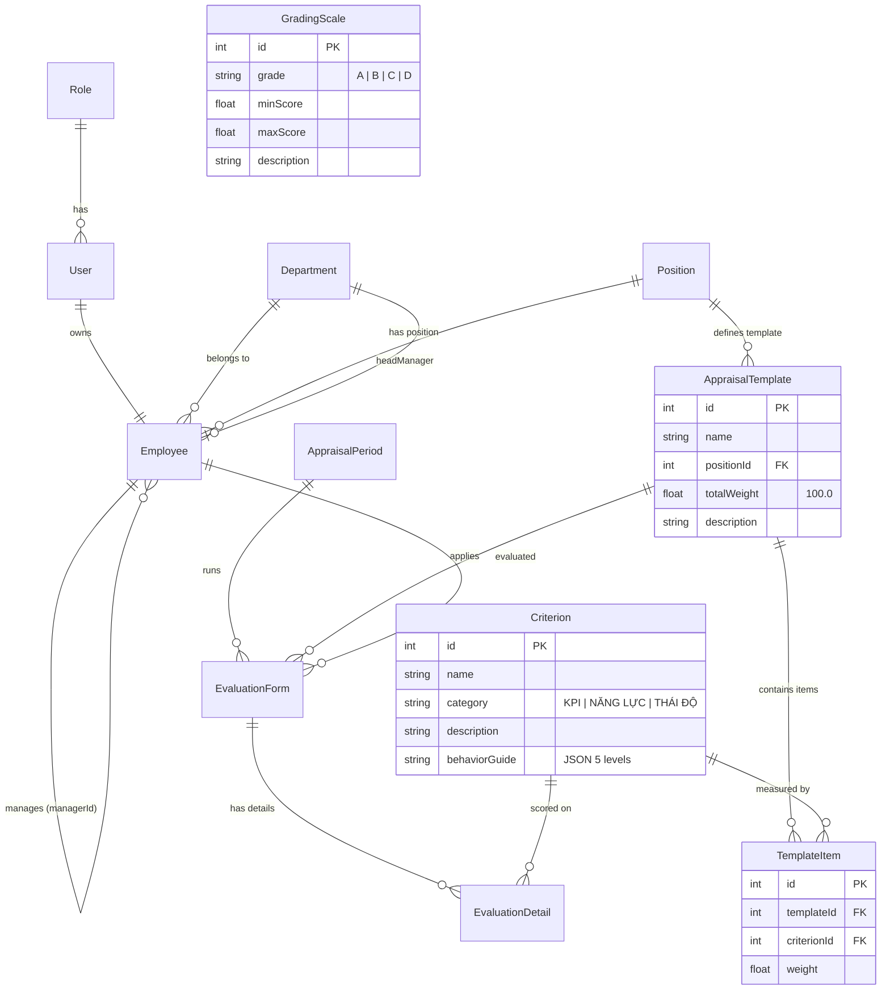

# BÁO CÁO KỸ THUẬT & KIẾN TRÚC HỆ THỐNG PMS ENTERPRISE
**Hệ thống Quản lý Hiệu suất & Đánh giá Xếp loại Nhân sự Doanh nghiệp**  
*Phiên bản kiến trúc: 2.0 (Next.js 16 • React 19 • TypeScript • Prisma 6 • PostgreSQL)*

---

## MỤC LỤC
1. [Tổng quan hệ thống & Những gì dự án đã làm được](#1-tổng-quan-hệ-thống--những-gì-dự-án-đã-làm-được)
2. [Cấu trúc thư mục & Giải thích chức năng từng file](#2-cấu-trúc-thư-mục--giải-thích-chức-năng-từng-file)
3. [Cơ chế hoạt động kỹ thuật cốt lõi (Core Architecture)](#3-cơ-chế-hoạt-động-kỹ-thuật-cốt-lõi)
4. [Phân hệ 2: Cấu hình Tiêu chí Rubric & Mẫu phiếu Đánh giá (US-02 - Hoàn thiện 100%)](#4-phân-hệ-2-cấu-hình-tiêu-chí-rubric--mẫu-phiếu-đánh-giá-us-02)
5. [Mô hình dữ liệu quan hệ (Database Schema & ERD)](#5-mô-hình-dữ-liệu-quan-hệ-database-schema--erd)
6. [Cẩm nang hỏi - đáp khi báo cáo (Defense Q&A Cheat Sheet)](#6-cẩm-nang-hỏi---đáp-khi-báo-cáo-defense-qa-cheat-sheet)

---

## 1. TỔNG QUAN HỆ THỐNG & NHỮNG GÌ DỰ ÁN ĐÃ LÀM ĐƯỢC

### 1.1. Bài toán nghiệp vụ
Hệ thống **PMS (Performance Management System)** được xây dựng nhằm giải quyết bài toán cốt lõi trong doanh nghiệp: **Định chuẩn hoá quy trình đánh giá, xếp loại nhân sự định kỳ**, khắc phục các nhược điểm truyền thống như đánh giá cảm tính, thiếu minh chứng, quản lý hồ sơ rời rạc trên nhiều file Excel và mất thời gian tổng hợp thủ công.

### 1.2. Những gì hệ thống đã hoàn thiện 100%

| Phân hệ / Chức năng | Mã US | Hiện trạng | Chi tiết kỹ thuật đã thực hiện |
| :--- | :---: | :---: | :--- |
| **Xác thực & Bảo mật RBAC** | `US-09` | **Hoàn thành 100%** | Phân quyền 3 vai trò: `HR` (Hội đồng nhân sự), `MANAGER` (Trưởng bộ phận), `EMPLOYEE` (Nhân viên). Cơ chế JWT mã hoá HS256 lưu trong `httpOnly` cookie. Mật khẩu mã hoá Bcrypt 10 rounds. Hỗ trợ Đổi mật khẩu cá nhân và Cấp lại mật khẩu mặc định (HR). |
| **Cơ cấu Tổ chức** | `US-01` | **Hoàn thành 100%** | Quản trị 14 phòng ban thực tế, gán Trưởng phòng phụ trách, tự động tính tổng số nhân sự trực thuộc. Quản lý danh mục chức danh công việc chuẩn toàn công ty. |
| **Hồ sơ Nhân sự & Phân cấp** | `US-01` | **Hoàn thành 100%** | Quản lý 120+ nhân sự thực tế. Thiết lập quan hệ phân cấp quản trị qua khóa `managerId` để định tuyến luồng duyệt KPI và chấm điểm cuối kỳ. Tự động sinh tài khoản `User` đồng bộ khi tạo mới nhân viên. |
| **Nhập / Xuất dữ liệu Excel** | `US-01` | **Hoàn thành 100%** | Xuất template `.xlsx` 3 sheet (Sheet mẫu nhập liệu + Sheet tham chiếu mã phòng ban + Sheet tham chiếu mã chức danh). Đọc buffer Excel, validate chặt chẽ (trùng mã NV, trùng email, sai định dạng, sai mã phòng), rollback an toàn và xuất báo cáo lỗi chi tiết từng dòng. |
| **Cây Sơ đồ Phân cấp (Org Chart)** | `US-01` | **Hoàn thành 100%** | Thuật toán dựng cây sơ đồ tổ chức động: Phòng ban $\rightarrow$ Trưởng bộ phận $\rightarrow$ Danh sách cấp dưới trực thuộc $\rightarrow$ Bóc tách danh sách nhân sự chưa gán cấp trên. |
| **Kho Tiêu chí Đánh giá Rubric** | `US-02` | **Hoàn thành 100%** | Quản lý kho tiêu chí chuẩn chia theo 3 nhóm cốt lõi: Kết quả công việc (`KPI`), Năng lực chuyên môn (`NĂNG LỰC`), Thái độ kỷ luật (`THÁI ĐỘ`). Thư viện mô tả hành vi 5 mức độ (⭐ 1 đến ⭐⭐⭐⭐⭐ 5 sao) tránh chấm điểm cảm tính. |
| **Mẫu phiếu theo Vị trí (Templates)** | `US-02` | **Hoàn thành 100%** | Xây dựng mẫu phiếu đánh giá cho từng vị trí chức vụ (`HEAD`, `SENIOR`, `SPECIALIST`, `ASSOCIATE`). **Ràng buộc nghiệp vụ bắt buộc: Tổng tỷ lệ trọng số = đúng 100%** (khóa lưu realtime và có thanh tiến độ cảnh báo). Chế độ Xem trước (Preview) giao diện mẫu phiếu trước khi phát hành. |
| **Thang điểm & Xếp loại (Grading Scales)** | `US-02` | **Hoàn thành 100%** | Bảng quy đổi điểm số tổng kết ra thứ hạng xếp loại: Hạng A (90-100), Hạng B (75-89), Hạng C (50-74), Hạng D (<50). Hỗ trợ chỉnh sửa khoảng điểm và mô tả tiêu chuẩn. |
| **Giao diện 3D Light SaaS** | Toàn bộ | **Hoàn thành 100%** | Thiết kế chuẩn Animate UI + GSAP. Canvas hạt ngọc 3D phản quang tương tác theo chuột. Bố cục Split-Screen sáng sủa, thẻ kính mờ (Light Glassmorphism), spring physics, tiếng Việt chuẩn ngữ pháp. |

---

## 2. CẤU TRÚC THƯ MỤC & GIẢI THÍCH CHỨC NĂNG TỪNG FILE

```
pms-system/
├── app/                               # Thư mục ứng dụng Next.js 16 (App Router)
│   ├── api/                           # Backend API RESTful routes
│   │   ├── auth/                      # Phân hệ xác thực & quản lý phiên
│   │   │   ├── login/route.ts         # Endpoint xác thực tài khoản & cấp JWT cookie
│   │   │   ├── logout/route.ts        # Endpoint thu hồi phiên đăng nhập
│   │   │   ├── me/route.ts            # Endpoint kiểm tra phiên làm việc hiện tại
│   │   │   ├── change-password/route.ts # Endpoint đổi mật khẩu cá nhân
│   │   │   └── reset-password/route.ts  # Endpoint cấp lại mật khẩu (quyền HR)
│   │   ├── departments/               # Phân hệ Quản lý Phòng ban
│   │   │   ├── route.ts               # GET danh sách PB, POST tạo PB mới
│   │   │   └── [id]/route.ts          # PUT cập nhật PB, DELETE xóa PB
│   │   ├── positions/                 # Phân hệ Quản lý Chức danh
│   │   │   ├── route.ts               # GET danh sách chức danh, POST tạo mới
│   │   │   └── [id]/route.ts          # PUT cập nhật chức danh, DELETE xóa
│   │   ├── employees/                 # Phân hệ Quản lý Nhân sự & Phân cấp
│   │   │   ├── route.ts               # GET danh sách NV, POST tạo mới NV + User
│   │   │   ├── [id]/route.ts          # PUT sửa NV, DELETE xóa NV
│   │   │   ├── import/route.ts        # POST đọc file Excel & validate nạp dữ liệu
│   │   │   └── template/route.ts      # GET xuất file Excel mẫu 3 sheet chuẩn
│   │   ├── criteria/                  # Phân hệ Kho Tiêu chí Rubric (US-02)
│   │   │   ├── route.ts               # GET danh sách tiêu chí, POST tạo mới
│   │   │   └── [id]/route.ts          # PUT sửa tiêu chí, DELETE xóa
│   │   ├── templates/                 # Phân hệ Mẫu phiếu Đánh giá (US-02)
│   │   │   ├── route.ts               # GET danh sách mẫu phiếu, POST tạo mẫu phiếu (Check sum = 100%)
│   │   │   └── [id]/route.ts          # GET chi tiết, PUT sửa mẫu phiếu, DELETE xóa
│   │   ├── grading-scales/            # Phân hệ Thang điểm Xếp loại (US-02)
│   │   │   ├── route.ts               # GET bảng thang điểm, PUT cập nhật hàng loạt
│   │   │   └── [id]/route.ts          # PUT cập nhật một thang điểm (A, B, C, D)
│   │   ├── org-chart/route.ts         # GET dữ liệu cây sơ đồ phân cấp managerId
│   │   └── docs/download/route.ts     # GET xem & tải tài liệu kỹ thuật định dạng HTML / PDF
│   ├── layout.tsx                     # Root layout, tích hợp Font, Ant Design Registry
│   ├── page.tsx                       # Dashboard tích hợp đầy đủ các view theo Role
│   └── globals.css                    # Tailwind CSS v4, Glassmorphism & UI theme
├── lib/                               # Thư viện dùng chung
│   ├── prisma.ts                      # Singleton Prisma Client kết nối PostgreSQL (Neon)
│   └── auth.ts                        # JWT Sign, Verify, Hash password, Get Session
├── prisma/
│   ├── schema.prisma                  # Data Model đầy đủ cho các Sprint
│   └── seed.ts                        # File tạo dữ liệu ban đầu
└── TAI_LIEU_KY_THUAT_HE_THONG_PMS.md  # Tài liệu kỹ thuật dự án
```

---

## 3. CƠ CHẾ HOẠT ĐỘNG KỸ THUẬT CỐT LÕI

### 3.1. Luồng Xác thực RBAC (Role-Based Access Control) với JWT Cookie
Hệ thống sử dụng cơ chế bảo mật xác thực hiện đại, không lưu token ở `localStorage` để chống tấn công XSS.



---

## 4. PHÂN HỆ 2: CẤU HÌNH TIÊU CHÍ RUBRIC & MẪU PHIẾU ĐÁNH GIÁ (US-02)

### 4.1. Kho tiêu chí đánh giá chuẩn (US-02.1)
- Tiêu chí được phân loại chuẩn theo **3 nhóm cốt lõi**:
  1. **Kết quả công việc (`KPI`)**: Đo lường sản lượng, chất lượng, tiến độ công việc được giao.
  2. **Năng lực chuyên môn (`NĂNG LỰC`)**: Đo lường kiến thức nghiệp vụ, kỹ năng giải quyết vấn đề, khả năng làm việc nhóm.
  3. **Thái độ kỷ luật (`THÁI ĐỘ`)**: Đo lường sự tuân thủ nội quy, văn hóa tổ chức, tinh thần trách nhiệm.
- **Thư viện mô tả hành vi (Rubric Guide)**:
  Mỗi tiêu chí đi kèm 5 mức độ hành vi tương ứng từ 1 đến 5 sao:
  - ⭐ Mức 1: Chưa đạt / Kém
  - ⭐⭐ Mức 2: Cần cải thiện
  - ⭐⭐⭐ Mức 3: Đạt chuẩn / Đạt yêu cầu
  - ⭐⭐⭐⭐ Mức 4: Tốt / Vượt mong đợi
  - ⭐⭐⭐⭐⭐ Mức 5: Xuất sắc / Hình mẫu

### 4.2. Mẫu phiếu đánh giá theo vị trí (US-02.2)
- Mỗi vị trí chức vụ (`Position`) được gắn với một Mẫu phiếu đánh giá (`AppraisalTemplate`).
- Trong mẫu phiếu, Hội đồng HR gán danh mục các tiêu chí (`TemplateItems`) kèm tỷ lệ trọng số (`weight`).
- **RÀNG BUỘC NGHIỆP VỤ BẮT BUỘC**:
  $$\sum_{i=1}^{n} \text{weight}_i = 100\%$$
  - Nếu tổng tỷ lệ trọng số khác $100\%$, hệ thống tự động khóa nút lưu, hiển thị thanh tiến độ cảnh báo số $\%$ còn thiếu hoặc dư thừa.
  - Hỗ trợ nút tiện ích **"Cân đối đều trọng số"** giúp tự động chia đều $100\%$ cho danh sách tiêu chí đã chọn.
- **Xem trước (Preview) Mẫu phiếu**:
  - Giao diện xem trước trực quan như biểu mẫu đánh giá thực tế: Thông tin nhân viên, chức danh, kỳ đánh giá, bảng phân loại tiêu chí kèm thang đo Rubric 1-5 sao, cột Tự đánh giá, Quản lý chấm, và ô chữ ký xác nhận 3 bên.

### 4.3. Thang điểm & Quy tắc Xếp loại (US-02.3)
Quy tắc quy đổi điểm số tổng kết ra thứ hạng xếp loại chuẩn:
- **Hạng A (Xuất sắc)**: $90 \to 100$ điểm.
- **Hạng B (Tốt)**: $75 \to 89$ điểm.
- **Hạng C (Hoàn thành)**: $50 \to 74$ điểm.
- **Hạng D (Chưa hoàn thành)**: Dưới $50$ điểm ($0 \to 49$).

---

## 5. MÔ HÌNH DỮ LIỆU QUAN HỆ (DATABASE SCHEMA & ERD)



---

## 6. CẨM NANG HỎI - ĐÁP KHI BÁO CÁO (DEFENSE Q&A CHEAT SHEET)

#### Q1: Tại sao hệ thống lại khóa không cho lưu khi tổng trọng số khác 100%?
> **Trả lời:**  
> "Trong toán học và quản trị hiệu suất, điểm đánh giá tổng kết của một nhân viên được tính bằng công thức trung bình có trọng số:
> $$\text{Score}_{\text{total}} = \sum (\text{Score}_i \times \text{Weight}_i)$$
> Nếu tổng trọng số khác $100\%$ (ví dụ $85\%$ hoặc $115\%$), điểm tổng kết cuối kỳ sẽ bị sai lệch thang đo quy đổi sang hạng A, B, C, D. Do đó, hệ thống áp dụng ràng buộc nghiệp vụ ở cả 2 tầng:
> 1. **Frontend**: Hiển thị thanh tiến độ trực quan và khóa nút Lưu (`disabled`).
> 2. **Backend**: Kiểm tra nghiêm ngặt `Math.abs(totalWeight - 100) <= 0.01`, nếu vi phạm sẽ từ chối lưu và trả về mã lỗi HTTP 400."

#### Q2: Thư viện mô tả hành vi (Rubric) giải quyết được nhược điểm gì trong đánh giá nhân sự?
> **Trả lời:**  
> "Đánh giá nhân sự truyền thống thường mắc lỗi cảm tính của người chấm (ví dụ: người quản lý khó tính chấm 3 điểm, người dễ tính chấm 5 điểm cho cùng một mức độ công việc).  
> Bằng cách xây dựng thư viện mô tả hành vi cụ thể cho từng cấp độ từ 1 đến 5 sao (Level 1 $\to$ Level 5), người chấm có thể đối chiếu hành vi thực tế quan sát được của nhân viên với tiêu chuẩn văn bản, đảm bảo tính khách quan, công bằng và minh bạch."

---
*Tài liệu kỹ thuật được tạo tự động bởi PMS Enterprise System Engineering Team.*
